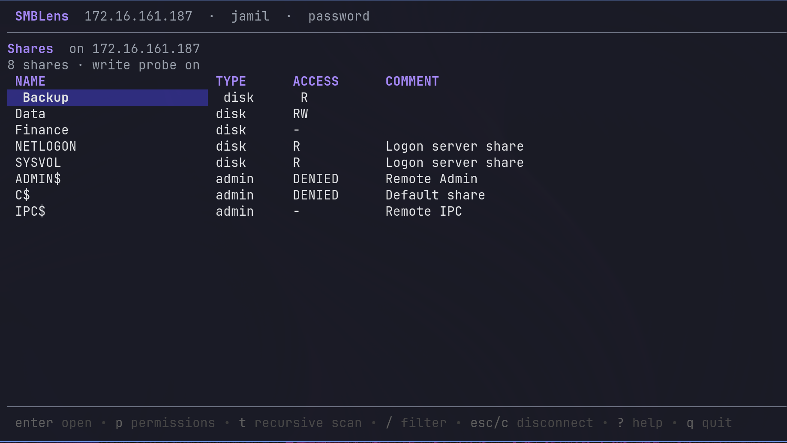

# SMBLens

SMBLens is an interactive terminal SMB client for Active Directory share enumeration. It connects with a password, an NT hash (pass-the-hash), or Kerberos.




## Installation

```go
go install github.com/mfkrypt/smblens@latest
```

## Quick start

SMBLens normally opens a login form. If you supply everything it needs on the command line, it connects immediately.

```bash
# Password
smblens 10.0.0.5 -u alice -d CORP -p 'S3cret!'

# NT hash (pass-the-hash), LM:NT input is accepted too
smblens 10.0.0.5 -u alice -d CORP -H 0123456789abcdef0123456789abcdef

# Kerberos from a credential cache (defaults to $KRB5CCNAME)
smblens fileserver.corp.example.com --auth kerberos --ccache /tmp/krb5cc_1000

# Kerberos with a realm and an explicit KDC
smblens fileserver.corp.example.com -u alice --auth kerberos \
  --realm CORP.EXAMPLE.COM --kdc dc01.corp.example.com -p 'S3cret!'

# Open one share directly and start a recursive scan when it opens
smblens 10.0.0.5/Data/finance -u alice -d CORP -p 'S3cret!' --recursive --depth 4

# Skip the automatic create/write/delete probe (read access is still checked).
# This does not make the session read-only: explicit uploads and deletes remain available.
smblens 10.0.0.5 -u alice -d CORP -p 'S3cret!' --no-write-probe
```

### Targets

The server argument accepts several forms:

| Form | Meaning |
| --- | --- |
| `host` | Port 445 |
| `host:1445` | Explicit port |
| `host/share` | Open the share directly |
| `host/share/docs` | Open the share at a path |
| `\\host\share\docs` | Windows UNC form |
| `smb://host/share` | URL form |
| `[::1]:445` | Bracketed IPv6 |
| `::1` | Unbracketed IPv6 |

Flags may come before or after the target.

## Authentication

| Method | How to select it |
| --- | --- |
| Password | `--auth password` (default) with `-u`, `-d`, `-p` |
| NT hash | `--auth hash` with `-H`, or simply pass `-H` |
| Kerberos | `--auth kerberos`, inferred from `--ccache`, `--keytab`, or `--kerberos-source` |

Usernames may be written as `alice`, `CORP\alice`, or `alice@corp.example.com`; an explicit domain inside the username wins over `-d`.

For password and NT-hash authentication, the domain is optional.

Kerberos credential sources, in default priority order:

1. `--ccache PATH` or `$KRB5CCNAME` (`FILE:` prefix accepted).
2. `--keytab PATH`.
3. `--password` with `--realm`.

Use `--kerberos-source password|ccache|keytab` to override the inference. Kerberos also needs:

- The **server's DNS name**, not its IP address, because the ticket is issued for `cifs/<hostname>`. If you must dial an IP, pass `--spn cifs/server.example.com` explicitly.
- A realm: `--realm CORP.EXAMPLE.COM`, or a `--domain` that matches it.
- A reachable KDC: `--kdc host[:port]` (port 88 is assumed when omitted), the KDC list in `krb5.conf`, or a DNS domain with `_kerberos._tcp` SRV records.
- A clock within five minutes of the KDC.

`--krb5-conf` selects a configuration file; otherwise `$KRB5_CONFIG` and `/etc/krb5.conf` are consulted. When neither exists, SMBLens builds a minimal configuration from `--realm` and `--kdc`.


## Reading the access column

SMB has no request that returns "what can this account do with this share". Share permissions and the NTFS ACL both apply, and ACL inspection alone does not account for share permissions. SMBLens answers the practical question by trying:

1. **Mount** the share.
2. **List** the share root (disk shares only).
3. Unless `--no-write-probe` is set, create `.smblens-probe-XXXXXXXXXXXX`, write the 7-byte marker `smblens` to it, and delete it (disk shares only).

`IPC$`, print queues, and device shares have no browsable file root. Their access column reflects a successful tree connect: `R`, the same READ that tools such as NetExec/nxc report. They are not write-probed, and pressing `enter` on one explains that it has no file tree; `p` still reads its security descriptor where the server exposes it.

| Label | Meaning |
| --- | --- |
| `RW` | Readable and writable |
| `R` | Readable; the write probe was denied, or a non-disk share connected successfully |
| `W` | Writable, but the root listing was denied |
| `R*` | Readable; write access was not tested (`--no-write-probe`) |
| `DENIED` | The account cannot mount the share |
| `ERROR` | The probe failed; press `p` or `i` for the reason |
| `-` | No access was demonstrated |

The probe file is deleted immediately after the test. On servers that keep a recycle bin, the server may retain a copy there. If the probe cannot be written or deleted, the reason is shown in the share's permission view (press `p`).

`--no-write-probe` skips only this automatic test. Read access is still checked by listing the share root, and the access column shows `R*` instead of `R`/`RW` because write access is unknown. It does **not** turn SMBLens into a read-only client: uploads, folder creation, renames, and deletions you explicitly invoke in the interface still work. If no writes at all should reach the server, use `--no-write-probe` and simply avoid those actions.

The permissions view (`p`) is separate: it shows the **security descriptor** — owner, group, and every ACE with decoded rights and inheritance (the NTFS ACL for file shares, the object/pipe ACL for `IPC$`). Reading it needs `READ_CONTROL` on the object; failing to read the ACL does not by itself mean the data is inaccessible.


## Project layout

```
main.go                     entry point, TTY check
internal/config/            command-line parsing and help
internal/smbclient/         SMB session, auth, shares, files, recursive walk and
                            download, security-descriptor parsing, friendly errors
internal/termtext/          terminal sanitisation for untrusted server text
internal/version/           version reporting from Go build metadata
internal/ui/                Bubble Tea application
  app.go                    root model, update/view routing, layout
  app_connection.go         dial, share enumeration, mounting
  app_keys.go               per-screen key handling
  app_dialog_actions.go     prompts, confirmations, file operations
  app_permissions.go        ACL lookups and the permissions dialog
  app_browse.go             directory listings and the viewer
  app_transfer.go           upload/download orchestration
  app_tree.go               recursive scan events and exports
  app_navigation.go         screen transitions and teardown
  app_help.go               help and error dialogs
  app_export.go             JSON exports
  shares.go, browser.go, tree.go, viewer.go, dialog.go, transfer.go,
  connect.go, keys.go, styles.go, format.go
```


## TODO:


1. Add video(gif) in readme (Add files in shares first for demo)
2. Test Kerberos auth with ccache tickets
3. Test NTLM auth
4. Re-Test permission display for specific Share read access
5. Review code for better understanding
